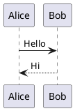

# Obsidian PlantUML Renderer

Renders PlantUML diagrams in Obsidian using a local native PlantUML binary (no Java) or PlantUML JAR. The plugin resolves local `!include` files within the vault before sending diagrams to the JAR.

## How it works

When a `plantuml` code block is rendered, the plugin resolves local `!include` directives recursively before passing the source to PlantUML. Includes are resolved relative to the markdown file's location and must stay within the vault, including after symlinks are resolved. As in PlantUML, only the first `@startuml`…`@enduml` block of a wrapped include file is inlined, and each file is included once: a file included in several `!if` branches still appears in whichever branch is taken.

The resolved source is piped to a persistent PlantUML process over stdin, and the SVG response is read back from stdout. PlantUML runs with its `SANDBOX` security profile, which blocks PlantUML from loading files or URLs itself. Keep shared includes inside the vault.

Bundled standard-library includes, such as `!include <archimate/Archimate>`, are passed to PlantUML and remain available in the sandbox.

## Why JAR-direct?

**Local PlantUML server** (e.g. `java -jar plantuml.jar -picoweb`) encodes diagrams in the request URL, which has an ~8 KB limit. Large diagrams with many `!include` files can exceed this and fail to render. It also requires a separate process to be running.

**Remote rendering** (e.g. `plantuml.com`) requires sending diagram source over the internet, which may not be suitable for proprietary or confidential content.

**JAR-direct** sidesteps the URL size constraint and keeps everything local, with `!include` resolution handled by the plugin.

## Requirements

- **PlantUML**, either:
  - a **native binary** (no Java needed) — download `native-plantuml-<platform>-<version>.zip` from the [PlantUML releases](https://github.com/plantuml/plantuml/releases/latest) and unzip it. On macOS, if the archive came from a browser, clear the quarantine flag: `xattr -d com.apple.quarantine plantuml`
  - or **Java** plus the **PlantUML JAR** from [plantuml.com](https://plantuml.com/download)
- **Graphviz** (optional) — required for certain diagram types (e.g. component, deployment) unless the layout engine is set to Smetana

## Installation

### Via BRAT (recommended)

1. Install the [BRAT](https://github.com/TfTHacker/obsidian42-brat) community plugin
2. Open **Settings → BRAT → Add Beta Plugin**
3. Enter this repository URL
4. Enable the plugin in **Settings → Community Plugins**

### Manual

1. Download `main.js` and `manifest.json` from the [latest release](../../releases/latest)
2. Create a folder `.obsidian/plugins/obsidian-plantuml-renderer/` in your vault
3. Copy both files into that folder
4. Enable the plugin in **Settings → Community Plugins**

## Configuration

Open **Settings → Obsidian PlantUML Renderer** and set:

| Setting | Default | Description |
|---------|---------|-------------|
| Native PlantUML path | _(empty)_ | Absolute path to a native `plantuml` executable; when set, the JAR and Java paths are ignored |
| PlantUML JAR path | _(required unless a native path is set)_ | Absolute path to `plantuml.jar` |
| Java path | `/usr/bin/java` | Path to the `java` executable |
| Graphviz dot path | `/opt/homebrew/bin/dot` | Path to the `dot` executable |
| Layout engine | Graphviz | Graphviz, or Smetana for PlantUML's built-in layout: no Graphviz needed and faster rendering, but layouts can differ |

## Usage

Wrap PlantUML source in a `plantuml` fenced code block:

~~~markdown

~~~

`!include` directives are resolved relative to the markdown file's location. Relative parent paths work within the vault; absolute paths and paths outside the vault are rejected.

## Diagram Navigation

Rendered diagrams are interactive. Large diagrams are scaled down to fit the note width automatically.

| Action | Effect |
|--------|--------|
| Cmd+Scroll | Zoom in / out toward the cursor |
| Drag | Pan around the diagram |
| Double-click | Reset to fit-to-width |
| Drag bottom edge | Resize the container vertically |

## Error Output

PlantUML returns an SVG even on syntax errors — the error message is embedded in the image itself. The plugin renders it as-is; there is no separate error state.

## Notes

- Desktop only — requires local Java and JAR
- Temporary files (`.plantuml-tmp-*`) are written alongside the markdown during rendering and deleted immediately after
